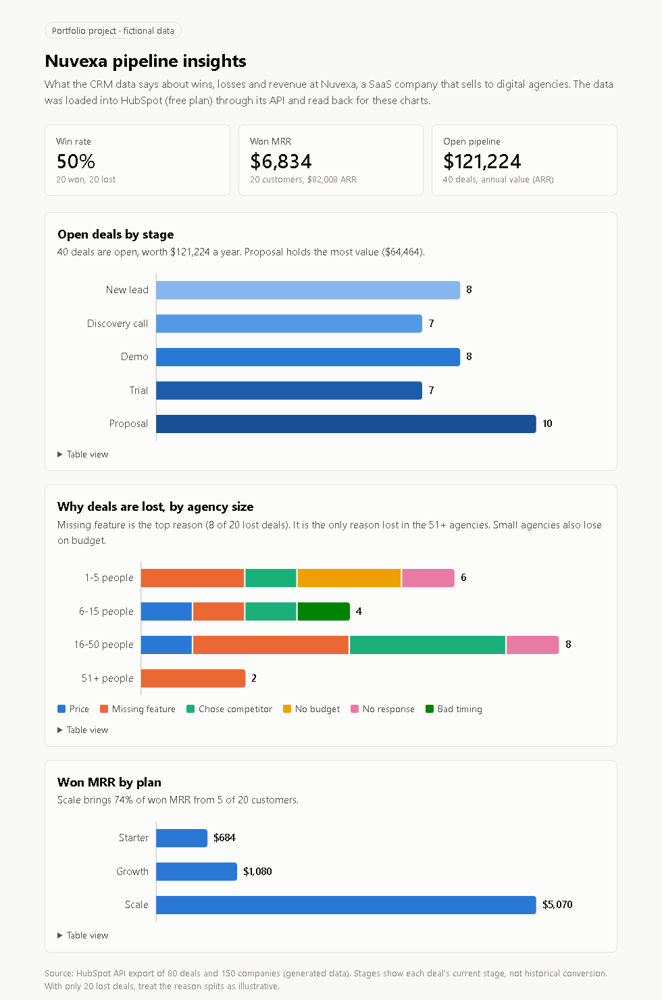

# Nuvexa: a HubSpot CRM portfolio project

> The company and all the data in this project are fictional: 150 companies, 150 contacts and 80 deals, generated by rules and loaded into a free HubSpot account through its API.


## The scenario

Nuvexa sells work-management software (projects, team, deliverables) to small and mid-sized digital agencies, on a monthly subscription priced per user. Its sales team needs to see where each agency is in the buying process, how much revenue is on the way, why deals get lost and which agencies to contact first.

HubSpot is the CRM Nuvexa's sales team would use for that. The product itself is a different tool, closer to Asana or Monday.com.

The project builds that CRM on HubSpot's free plan: a data model, one sales pipeline, imported data, segments, a dashboard, and an analysis for the parts the free plan does not cover.

## What I built

### Data model
Nine custom properties (the free plan allows ten), reusing native HubSpot fields wherever they existed. Anything meant for a report is a dropdown.

| Object | Custom properties |
|---|---|
| Contact | Agency role |
| Company | Agency size segment, Agency clients count, Current tool, Agency specialty |
| Deal | Plan, Number of users, Loss reason, MRR |

### Sales pipeline
The free plan allows one pipeline, so I renamed the stages of the default one:

`New lead 10%` → `Discovery call 20%` → `Demo 40%` → `Trial 60%` → `Proposal 80%` → `Closed Won 100%` / `Closed Lost 0%`

The percentage is the estimated chance of closing from that stage. Loss reasons are Price, Missing feature, Chose competitor, No budget, No response and Bad timing.

### Data
`scripts/generate_data.ps1` creates the companies, contacts and deals with a fixed random seed, so the result is reproducible. Agency size sets the number of users, the number of users sets the plan (Starter up to 8 seats, Growth up to 25, Scale above), and seats × price ($12, $20, $30) gives the MRR. ARR is MRR × 12. Only lost deals have a loss reason, and closed deals close before today.

The 80 deals are split as 8 New lead, 7 Discovery call, 8 Demo, 7 Trial, 10 Proposal, 20 Closed Won and 20 Closed Lost.

### Import
`scripts/import_hubspot.ps1` loads companies, then contacts, then deals through the HubSpot API, with the associations set when each record is created. It can be run again without creating duplicates. I imported 3 deals first and read them back from the API before loading the rest.

The token comes from the `HUBSPOT_TOKEN` environment variable and is never written to a file. The service key only has read and write access to companies, contacts and deals, plus read-only access to their properties.

### Segments and dashboard
Four active segments (the limit is ten): Customers (20), Open opportunities (40), Lost deals contacts (20) and Spreadsheet agencies (42 companies that still manage projects in spreadsheets, the best sales target). I also added HubSpot's ready-made deal reports to the dashboard and renamed their titles to English.


### Analysis outside HubSpot
Custom reports are locked on the free plan, so HubSpot cannot chart deals by loss reason or by plan. `dashboard/nuvexa-pipeline-insights.html` uses the data read back from the API to chart both.



## What the data shows

- Win rate of 50% (20 won, 20 lost).
- Won MRR of $6,834 from 20 customers, which is $82,008 in ARR.
- Open pipeline of $121,224 a year across 40 deals, with Proposal holding the most value.
- Missing feature is the top loss reason (8 of 20), and the only one in agencies with 51 or more people.
- The Scale plan brings 74% of the won MRR from 5 of the 20 customers.

## Things that did not go as expected

- A field called "Job function" already existed, but it was a free-text field from an ads integration, so I created my own dropdown, "Agency role".
- HubSpot's "Closed Lost Reason" is free text, which cannot be grouped in a chart, so I created a "Loss reason" dropdown.
- HubSpot's MRR and ARR properties are calculated and cannot be written, so I created an "MRR" property.
- Private apps no longer exist on the account, so the import uses a service key.
- The API first answered with a 401 error because I had saved the wrong text as the token. A missing permission would have returned a 403, so the problem had to be the credential itself.
- One segment showed 40 contacts when I expected 17. HubSpot automatically moves any contact with an open deal to Opportunity, whatever the stage.
- The option to build a report from scratch is locked on the free plan, which is why the last chart set lives outside HubSpot.

## Limitations

- The free plan limits I worked with came from third-party sources and my own tests: 10 custom properties, 1 pipeline, no custom reports, 10 active segments, 2 users and 1,000 contacts. Check HubSpot's pricing page for the current numbers.
- Contacts were created on the import date, so "contacts added over time" is a single spike.
- The charts show each deal's current stage, not historical conversion.
- There is no automation, because of the free plan.
- All data is fictional and only 20 deals were lost, so the figures show how the analysis works, not a conclusion about a market.

## Repository

```
data/        companies.csv, contacts.csv, deals.csv, hubspot_deals_export.json
scripts/     generate_data.ps1, import_hubspot.ps1, dashboard_template.html
dashboard/   nuvexa-pipeline-insights.html (open it in a browser)
images/      screenshots used above
```

## Run it yourself

1. Create a free HubSpot account and the custom properties above. The internal names must match: `agency_role`, `agency_size_segment`, `agency_clients_count`, `current_tool`, `agency_specialty`, `plan`, `number_of_users`, `loss_reason` and `mrr`.
2. Create a service key with read/write on companies, contacts and deals, plus read-only access to their properties, and store it in the `HUBSPOT_TOKEN` environment variable.
3. Generate the data: `powershell -ExecutionPolicy Bypass -File scripts/generate_data.ps1`
4. Import a sample first, then everything: `scripts/import_hubspot.ps1 -Mode Sample`, then `-Mode Full`.

It needs Windows PowerShell 5.1. The import script saves the IDs it creates in `data/import_state.json`, which is listed in `.gitignore`.

---
*Author: Alberto Stephan · [LinkedIn](https://www.linkedin.com/in/albertostephan)*
