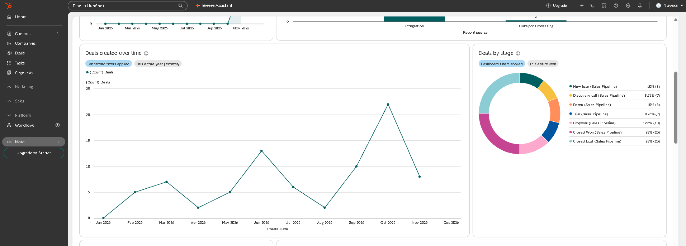
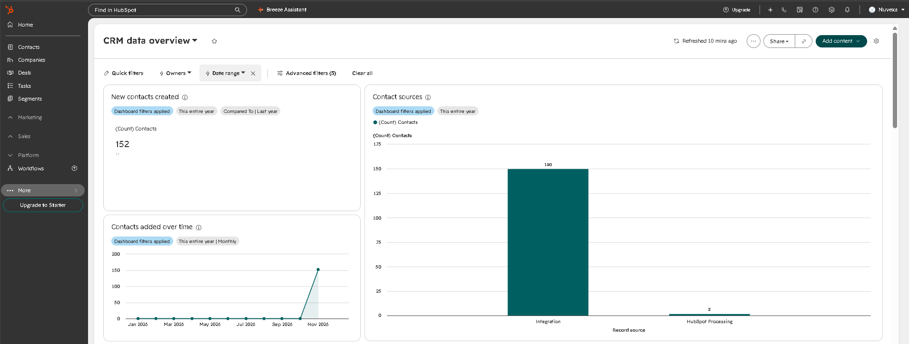

# Nuvexa: a HubSpot CRM portfolio project (free plan)

> **All data in this project is fictional.** Nuvexa is a made-up company. The 150 companies, 150 contacts and 80 deals were generated by rules and loaded into a HubSpot **free** account through its API. The goal is to show how I structure a CRM, not results from a real business.



## The case in one minute

| | |
|---|---|
| **Company (fictional)** | Nuvexa, a B2B SaaS that sells work-management software (projects, team, deliverables) to small and mid-sized digital agencies. Monthly subscription, priced per user. |
| **Problem** | The sales team cannot see where each agency is in the buying process, how much revenue is coming, why deals are lost, or which agencies to approach first. |
| **Solution** | A HubSpot CRM, used by Nuvexa's own sales team, with a data model, one sales pipeline, segments and a dashboard, built **inside the limits of the free plan**. |
| **My role** | Design the structure, generate coherent data, import it by API, build the views, and document what the plan could not do. |

Note on the two systems: Nuvexa's **product** is project-management software for agencies (like Asana or Monday.com). **HubSpot is the CRM Nuvexa uses internally to sell it.** They are different tools.

## What I built

### 1. Data model (9 of the 10 custom properties the free plan allows)
The rule: **use a native HubSpot field before creating a new one.** Dropdowns for anything that will be grouped in a report, because free text does not group.

| Object | Custom properties |
|---|---|
| Contact | Agency role |
| Company | Agency size segment, Agency clients count, Current tool, Agency specialty |
| Deal | Plan, Number of users, Loss reason, MRR |

### 2. One sales pipeline (the free plan allows one)
I renamed the stages of the default pipeline instead of creating another one.

`New lead 10%` → `Discovery call 20%` → `Demo 40%` → `Trial 60%` → `Proposal 80%` → `Closed Won 100%` / `Closed Lost 0%`

The percentage is the estimated chance of closing from that stage. Loss reasons: Price, Missing feature, Chose competitor, No budget, No response, Bad timing.

### 3. Coherent fictional data
Generated by `scripts/generate_data.ps1` (fixed random seed, so it is reproducible).

- Agency size drives the number of users, users drive the plan (Starter up to 8, Growth up to 25, Scale above), and users × price per seat gives the MRR (`$12`, `$20`, `$30`). ARR is MRR × 12.
- Only lost deals have a loss reason.
- Closed deals close before today, open deals have a future expected close date.
- 80 deals: 8 New lead, 7 Discovery call, 8 Demo, 7 Trial, 10 Proposal, 20 Closed Won, 20 Closed Lost.

### 4. Import through the HubSpot API
`scripts/import_hubspot.ps1` creates companies, then contacts, then deals, with the associations set at creation. It is resumable and does not create duplicates. I first imported a 3-deal sample, checked it by reading it back from the API, and only then imported the rest.

The access token is read **only from the `HUBSPOT_TOKEN` environment variable**. It is never written to a file, code or log. The service key uses the minimum scopes (read/write for companies, contacts and deals, plus read-only schema).

### 5. Segments and dashboard
Four active segments (the plan allows 10): **Customers** (20), **Open opportunities** (40), **Lost deals contacts** (20) and **Spreadsheet agencies** (42 companies that still manage projects in spreadsheets, the best sales target). I also added HubSpot's ready-made deal reports to the dashboard and renamed them to English.



### 6. Analysis outside HubSpot
On the free plan, custom reports are locked, so HubSpot cannot chart deals by `Loss reason` or by `Plan`. I read the data back through the API and built `dashboard/nuvexa-pipeline-insights.html` to answer those two questions. I treated this as a documented limit of the plan, not something to work around.


## What the data shows (illustrative)
- **Win rate 50%** (20 won, 20 lost).
- **Won MRR $6,834** from 20 customers ($82,008 ARR).
- **Open pipeline $121,224** a year across 40 deals; Proposal holds the most value.
- **Top loss reason: Missing feature** (8 of 20), and the only reason in agencies with 51+ people.
- **Revenue is concentrated:** the Scale plan brings 74% of won MRR from 5 of 20 customers.

With only 20 lost deals and fictional data, these numbers show how the analysis would work, not a conclusion about a market.

## What went wrong, and what I learned
| What happened | Lesson |
|---|---|
| A field named "Job function" already existed, but it was free text created by an ad integration. | Check a field's **type and origin** before assuming it fits. |
| The native "Closed Lost Reason" is free text, not a list. | Free text does not chart. I created a dropdown. |
| Native MRR and ARR are calculated and read-only. | Check a native field is **writable** before planning on it. I created an `MRR` property. |
| Private apps no longer exist on the account. | The replacement is a **service key**. Platforms change, so check current docs. |
| The API returned `401 INVALID_CLAIMS` because I had saved the wrong text as the token. | A 401 is a **credential** problem; a 403 would be missing scope. Debug by eliminating causes in order. |
| A segment showed 40 contacts when I expected 17. | HubSpot **automatically moves contacts with an open deal to Opportunity**, regardless of stage. Always validate a segment size against the source. |
| The "create report from scratch" button is locked on the free plan. | Document the limit and deliver the analysis another way. |

## Free-plan limits I worked within
10 custom properties, 1 deal pipeline, ready-made reports only (no custom report builder), 10 active segments, 2 users and 1,000 contacts. These came from third-party sources and my own testing, so verify them against HubSpot's current pricing page.

## Repository
```
data/        companies.csv, contacts.csv, deals.csv, hubspot_deals_export.json
scripts/     generate_data.ps1, import_hubspot.ps1, dashboard_template.html
dashboard/   nuvexa-pipeline-insights.html (open in a browser)
images/      screenshots used above
```

## Run it yourself
1. Create a free HubSpot account and the custom properties listed above (the property names must match: `agency_role`, `agency_size_segment`, `agency_clients_count`, `current_tool`, `agency_specialty`, `plan`, `number_of_users`, `loss_reason`, `mrr`).
2. Create a **service key** with the scopes listed in section 4 and store it in an environment variable. Do not paste it into a file.
3. Generate data: `powershell -ExecutionPolicy Bypass -File scripts/generate_data.ps1`
4. Import a sample first, then everything: `scripts/import_hubspot.ps1 -Mode Sample`, then `-Mode Full`.

Requires Windows PowerShell 5.1. The import script saves created IDs in `data/import_state.json` (listed in `.gitignore`).

## Honest limits of this project
- Fictional data, generated by rules, with a small sample.
- Contacts were created on the import date, so "contacts added over time" shows one spike.
- Stages in the charts are each deal's **current** stage (a snapshot), not historical conversion.
- Built on a free plan, so there is no automation or custom reporting.

---
*Author: Alberto Stephan · [LinkedIn](https://www.linkedin.com/in/albertostephan)*
